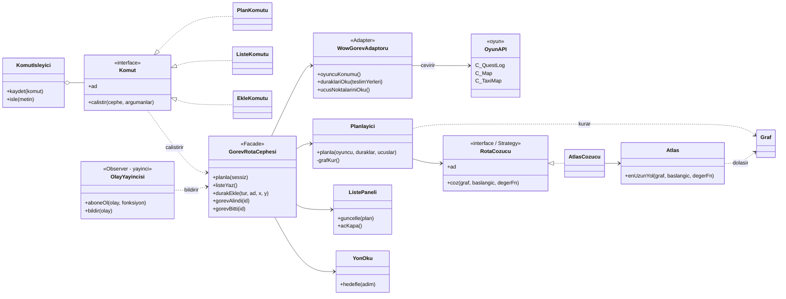

# GörevRota — Tasarım Belgesi

Bu belge, eklentide hangi tasarım desenlerinin nerede ve neden kullanıldığını,
hangi SOLID ilkesine hizmet ettiklerini ve sınıflar arası ilişkiyi anlatır.

## 1. Genel akış

Tahtadaki şemanın koddaki karşılığı:

```
Oyun (görev kütüğü, harita)  →  Adapter  →  Duraklar  →  Planlayıcı  →  ATLAS  →  Sıralı liste paneli
   C_QuestLog, C_Map            WowGorev     AL/HEDEF/    süre ağırlıklı  core/     ListePaneli + YonOku
                                Adaptoru     TESLIM       graf kurar      atlas.lua
```

1. Oyuncu `/gr plan` yazar → **Command** nesnesi **Facade**'ı çağırır.
2. Facade, **Adapter** ile oyundan görevleri ve konumları okur.
3. Planlayıcı durakları ve uçuş noktalarını süre ağırlıklı bir grafa çevirir,
   **Strategy** arayüzü üzerinden **ATLAS**'a çözdürür.
4. Sonuç panelde oklarla sıralanır, oyunun yön oku ilk durağa çevrilir.
5. Görev alınınca/bitince oyun olay yayınlar → **Observer** aboneleri planı yeniler.

## 2. Desenler

| Desen | Dosya | Neden kullanıldı? | SOLID ilkesi |
|---|---|---|---|
| **Adapter** (Uyarlayıcı) | `oyun/wow_gorev_adaptoru.lua` | Oyunun API'si (C_QuestLog, C_Map, C_TaxiMap) bizim durak modelimizle uyumsuz: harita koordinatı verir, görev başlıkları ve gizli görevler içerir. Adaptör bunları "AL / HEDEF / TESLİM durakları + kıta koordinatı"na çevirir. Oyun API'si değişirse yalnızca bu dosya değişir. | **SRP** (tek görevi çeviri), **DIP** (oyun fonksiyonları `api` tablosuyla dışarıdan verilir; testte sahte API kullanılır) |
| **Facade** (Cephe) | `GorevRotaCephesi.lua` | Komutlar ve olaylar; adaptör, planlayıcı, panel, yön oku ve kayıtlı veriyle ayrı ayrı uğraşmasın diye hepsi `planla()`, `listeYaz()`, `durakEkle()` gibi birkaç sade yöntemin arkasına saklandı. e-Devlet kapısı gibi: tek kapı, arkada birçok sistem. | **DIP** (bütün parçalar yapıcıya verilir), **ISP** (komutlar yalnızca ihtiyaç duydukları sade yöntemleri görür) |
| **Observer** (Gözlemci) | `oyun/olay_yayincisi.lua` | Oyun, görev alınınca/bitince olay yayınlar. Eklentinin parçaları bu olaylara abone olur; yayıncı kimin dinlediğini bilmez. Yeni bir tepki (ör. uçuş haritası açılınca noktaları kaydetmek) için yalnızca yeni abone eklenir. | **OCP** (yayıncı değişmeden yeni abone eklenir), **SRP** |
| **Command** (Komut) | `komutlar/komutlar.lua` | Her `/gr` komutu kendi `calistir()` yöntemi olan ayrı bir nesne. `KomutIsleyici` (çağıran) metni çözüp doğru komutu bulur; işi Facade (alıcı) yapar. Yeni komut eklemek için işleyiciye dokunmak gerekmez. | **OCP**, **SRP** (çözümleme ile iş ayrı) |
| **Strategy** (Strateji) | `core/rota_cozucu.lua` | Rota hesaplama bir "algoritma ailesi"dir. Planlayıcı yalnızca `RotaCozucu` arayüzünü (`ad`, `coz()`) bilir. Tek somut strateji `AtlasCozucu` (hocanın ATLAS algoritması). | **OCP** (yeni çözücü eklemek planlayıcıyı değiştirmez), **LSP** (arayüze uyan her çözücü yerine geçebilir), **DIP** |

Not: Ödev şartı gereği rotayı **yalnızca ATLAS** hesaplar. Strategy deseni başka
algoritma kullanmak için değil, rota hesabını planlayıcıdan ayırmak için var.

### Desen dışında SOLID'e katkı yapan kararlar

- **SRP:** `core/` klasörü oyunu hiç bilmez (yalnızca graf ve algoritma). Panel yalnızca
  çizer, `metinler.lua` yalnızca metinleri tutar, `GorevRota.lua` yalnızca parçaları bağlar.
- **DIP:** Oyunun global fonksiyonlarına (CreateFrame, C_QuestLog ...) yalnızca `GorevRota.lua`
  dokunur. Bu sayede eklentinin tamamı `tests/sahte_wow.lua` ile oyun olmadan test edilebiliyor.
- **ISP:** Panelin arayüzü üç yöntem: `guncelle(plan)`, `ac()`, `acKapa()`. Yön okunun tek yöntemi: `hedefle(adim)`.

## 3. ATLAS planlamada nasıl kullanılıyor?

`core/atlas.lua`, hocanın `Atlas.java` dosyasının satır satır çevirisidir ve örnek grafta
(`bbtas.kiss2.fsm`) Java ile **birebir aynı** sonucu verir (`tests/atlas_test.lua`).
Algoritmanın içine dokunulmadı; yalnızca kenar "değeri" dışarıdan verilebilir hâle geldi.

Planlayıcı (`core/planlayici.lua`) ATLAS'a şu grafı verir:

| Graf öğesi | Oyundaki karşılığı |
|---|---|
| Düğüm | Oyuncunun yeri, her durak, bilinen her uçuş noktası |
| Yürüme kenarı | En yakın 5 komşu (400 yarddan yakınsa); kopuk parçalar en kısa kenarla birleştirilir (Kruskal) |
| Uçuş kenarı | Bilinen uçuş noktaları arası |
| **Gerekli kenar** | Her durakta kendine dönen kenar (ATLAS bunları kapsayan bir yürüyüş arar) |
| Ağırlık | Süre (saniye) = mesafe / hız |

Değer fonksiyonu: yapılmamış ve önkoşulu (aynı görevin önceki aşaması) bitmiş durak kenarı
`ODUL − süre`, diğer kenarlar `− süre`. ATLAS üç tur çalışır (ODUL = 60, 300, sınırsız):
önce yakın duraklar toplanır, uzaklar sona kalır; geri dönüş olmaz.

## 4. Sınıf diyagramı (Mermaid)



## 5. Kâğıda çizilecek sade hâli

Kutuları çizip okları aynen koymak yeterli. Köşeli parantez içindeki adı kutunun üstüne yazın.

```
   [Command]                         [Observer]
  /gr plan, /gr list ...           oyun olayları (QUEST_ACCEPTED ...)
        |                                  |
        v                                  v
   +-------------------------------------------+
   |        GorevRotaCephesi   [Facade]        |
   +-------------------------------------------+
     |              |               |        |
     v              v               v        v
 WowGorev        Planlayici     ListePaneli  YonOku
 Adaptoru            |           (panel)    (yön oku)
 [Adapter]           v
     |          <<RotaCozucu>>  [Strategy]
     v               ^
  Oyun API           |  (uygular)
 (C_QuestLog,    AtlasCozucu ──> ATLAS (Atlas.java çevirisi)
  C_Map)
```

Okların anlamı: `──>` "kullanır", `^ (uygular)` "arayüzü gerçekler".
